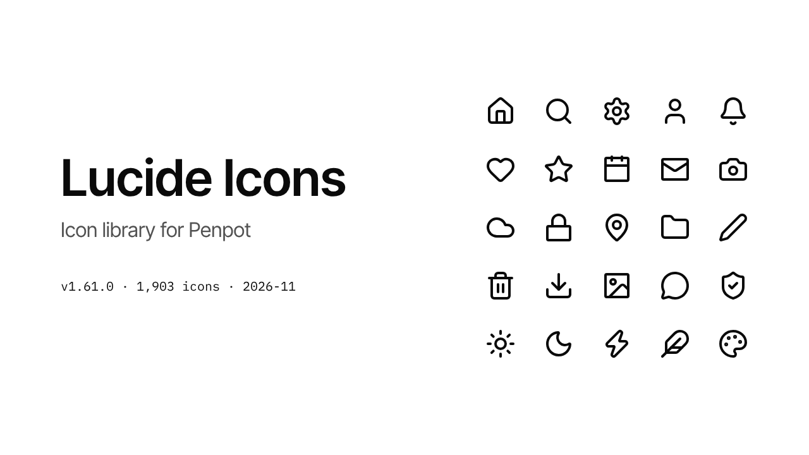

# Lucide Icons for Penpot

The [Lucide](https://lucide.dev) icons as a shared library for [Penpot](https://penpot.app): every icon is a component, named as in Lucide and coloured by a token.

The file is generated from the package `lucide-static`, so it holds exactly the icons of one Lucide version. This release holds Lucide 1.61.0 with 1,903 icons.

This is not an official project of Lucide or of Penpot.

## Use it

1. Download `lucide-icons.penpot` from the [latest release](https://github.com/shiroink-dev/penpot-lucide-icons/releases/latest).
2. Import it into a Penpot project.
3. Open it, and in the menu beside the file name choose **File > Add as Shared Library**.
4. In the file you design in, open **Libraries** in the assets panel and connect "Lucide Icons".

The icons then appear among the assets of that file. An icon you place is a copy of the component in the library, and it follows when the library changes.

## What an icon is

- **Name.** The name Lucide gives it, such as `house`, `circle-alert` or `ellipsis`. There are no folders.
- **Size.** 24 by 24, with a stroke of 2, round ends and round corners.
- **Scaling.** The drawing scales with its frame. The stroke keeps its width unless you resize with the scale tool (K), which scales both.
- **Colour.** The stroke is the colour token `foreground` of the token set `Lucide`, `#0A0A0A`. A copy takes another colour like any shape.

The icons lie on three pages, "Icons A–O", "Icons P–S" and "Icons T–Z", with a board for each first letter. Penpot becomes too slow to work on when one page holds all of them.

## Versions

A release carries the version of Lucide it holds: release `v1.61.0` holds the icons of Lucide 1.61.0. Choose the release that matches the `lucide` package of your code, and the names in the design are the names in the code.

## Build it yourself

`generate.js` builds the icons in the Penpot file that is open. It is the body of an async function for Penpot's plugin context, where `penpot` is the Plugin API. The [Penpot MCP server](https://github.com/penpot/penpot/tree/develop/mcp) runs it as it is with its tool `execute_code`.

1. Create an empty file in Penpot and connect it to the MCP server.
2. Set `version` in `CONFIG` at the head of `generate.js`.
3. Run the script, and run it again until it returns `{ done: true }`.

One run does what fits into `budgetMs` and the next takes up where it stopped.

The script loads the icons from `unpkg.com`. It was written and run with Penpot 2.19.1.

The pages "Cover" and "Read me" are drawn by hand. They name the version and the number of icons, and are brought up to date with each release.

## Bring a file up to another Lucide version

Set `version` and run the script in the file you built earlier, again until it returns `{ done: true }`. It compares the file with that version of Lucide:

- **An icon Lucide added** is built.
- **An icon Lucide has drawn anew** keeps its component and gets the new drawing inside it, so every copy in a design keeps its link. A copy you had resized shows the new drawing at 24 by 24 and needs resizing once more.
- **Every icon** is put in its alphabetical place.
- **An icon Lucide dropped** is left alone, because designs may still use it. It is moved behind the others of its letter, and the result names it under `dropped`. Delete it by hand once nothing uses it.

The script tells one drawing from another by a note it leaves on each icon. An icon without that note is drawn anew.

## License

The file and the script are released under the [MIT license](LICENSE).

The icons are Lucide's, released under the ISC license, and those derived from Feather under the MIT license. The text is in [LICENSE-LUCIDE](LICENSE-LUCIDE), and the page "Read me" of the file carries it as well.
